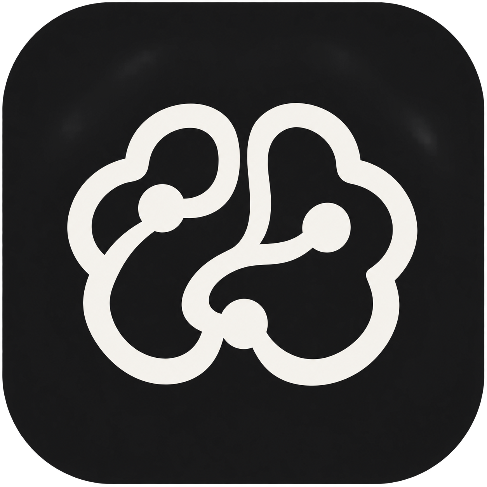

<p align="center">
  
</p>

# Brain Companion marketplace

Four portable workflows bundled with the hosted [Brain Companion](https://brain.wilsondetorres.com) MCP:

| Skill | Purpose |
|---|---|
| `brain-recall` | Retrieve prior context with sources. |
| `brain-capture` | Save useful, sourced knowledge under the owner's policy. |
| `brain-review` | Review authorized pending work. |
| `brain-maintain` | Check health or perform authorized maintenance. |

The plugin connects to `https://brain.wilsondetorres.com/mcp` through your client's OAuth flow. **Owner-only preview:** this deployment currently accepts only its configured owner's Google account. Other users cannot onboard to it yet; use the custom-endpoint route below for a Brain deployment you control. Publishing this URL does not grant access to the Brain.

The application, MCP server and canonical skill source remain in [brain-companion](https://github.com/wdetorres/brain-companion).

## Install the hosted bundle

The public catalog contains `brain-workflows` version `0.2.1`: four skills plus the `brain-companion` MCP server.

```sh
# Claude Code
claude plugin marketplace add wdetorres/brain-companion-marketplace
claude plugin install brain-workflows@brain-companion

# Codex
codex plugin marketplace add wdetorres/brain-companion-marketplace
codex plugin add brain-workflows@brain-companion
```

Complete owner sign-in and consent in that client. Existing users of the skills-only `0.1.0` package should refresh the marketplace and update the plugin to receive the connector. Reconcile an existing manual connection to this same endpoint rather than keeping duplicate connections or copying its tokens.

## Use your own MCP endpoint

With Git and Python 3 installed:

```sh
git clone https://github.com/wdetorres/brain-companion-marketplace.git
cd brain-companion-marketplace
python3 scripts/configure.py \
  --mcp-url 'https://your-brain.example/mcp' \
  --output dist/my-brain
```

Replace the example URL with your deployed HTTPS MCP endpoint. This builds a local catalog containing four skills and one MCP server. It does not contact the endpoint, register hooks, install anything or change server permissions. The URL must not contain credentials, a query string or a fragment. Complete OAuth through your client's own connection flow after installation.

Install the generated catalog in **one** supported client:

```sh
# Claude Code
claude plugin marketplace add ./dist/my-brain
claude plugin install brain-companion@brain-companion-local

# Codex
codex plugin marketplace add ./dist/my-brain
codex plugin add brain-companion@brain-companion-local
```

Keep the generated directory available for future marketplace refreshes. `dist/` is ignored by Git because its configuration belongs to you. Rebuild into a new directory; the builder refuses to overwrite an existing package. Discard an incomplete build if the command fails. Choose one installation route to avoid duplicate skills.

Installation, OAuth and successful tool calls are separate checks. In a fresh session, verify the four skills, authenticate with the intended Brain owner, then call only `brain_status`, bounded `search` and `inspect` to confirm the expected Brain and policy. Installing these skills does not authorize writes or activate a collector.

## Client support and hooks

Claude Code and Codex package discovery are verified locally. The [Claude manifest](https://code.claude.com/docs/en/plugins-reference) declares the listing icon; the [Codex compatibility manifest](https://developers.openai.com/plugins/build/plugins) adds the logo and composer icon. Both point to the same bundled asset and MCP configuration. Claude Code currently ignores listing icons at load time; its directory can use them when a plugin is submitted.

[Grok Build documents Claude plugin compatibility](https://docs.x.ai/build/features/skills-plugins-marketplaces), but this repository has not been tested in Grok Build. Grok Bot uses its own [private-skill and connector flows](https://docs.x.ai/grok-bot/skills-routines-and-automations). ChatGPT and Claude Chat have separate import/connection flows; these CLI commands do not install there.

No hooks are bundled. Hooks need an explicit, runtime-specific opt-in and a verified consumer; a completion marker alone does not save a memory. OpenAI's [public plugin directory excludes lifecycle hooks](https://developers.openai.com/plugins/build/plugins#bundled-mcp-servers-and-lifecycle-hooks). A public GitHub marketplace is separate from submission to any client's official directory.

## Maintenance

Run `python3 -m unittest discover -s tests -v`. It uses only the Python standard library. See [validation](docs/validation.md) for native client checks and their limits.

[source.json](source.json) pins the application commit and SHA-256 hashes of the ten distributed skill files. Refresh only those files from the canonical repository, review their content, update the hashes and plugin version, and rerun validation before committing. Do not copy application data, owner setup, authentication state or generated endpoint configuration into a release. The public marketplace does not make the current single-owner server a multi-user service.
